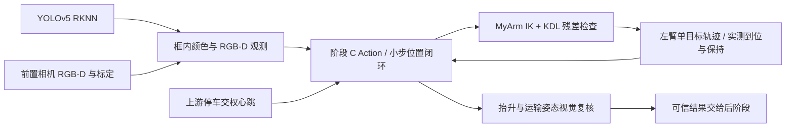

# 阶段 C 实现索引与验收边界

2026-10-17：新增 `jzzj_grasp_interfaces`、`jzzj_grasp`，扩展 `jzzj_visual_servo`，提供左臂 opt-in 轨迹模式及总任务薄适配。

[完整接入文档、架构与测试记录](../mission_ws/src/mission/jzzj_grasp/README.md)

## 与原架构的差异

- YOLO 是唯一检测来源；框内 HSV 仅筛颜色，不替代检测器。
- 新视觉链不向底盘发布 Twist，C 不修改车辆位置。
- Action 取代“阶段字符串即动作完成”的假设；session/GoalID 关联交接、反馈和结果。
- 实际执行器具有取消保持确认、旧/新驱动互斥和故障锁存；真实硬件默认关闭。
- 旧私有 remap/YAML 层级已修正；旧整车 GrabCmd/后置 AprilTag/工作空间初始化问题不在本轮修复。

## 本地验证与现场门槛

已完成纯算法、模拟和回调替身测试，记录见完整说明。没有 ROS、catkin、C++/ARM64 工具链或机器人连接，未完成真实构建/推理/动作验收。模型和标签、TCP/外参/夹爪与工作区标定必须由现场补齐；之后按观测、空载、带物、异常场景及上下游交接顺序验证。

本索引不覆盖其他负责人对 A/B/D/E 的实现，也不把 C 模拟成功称作整车任务完成。

## 外部水果模型接入补充

2026-10-17：增加六类中性标签与模型 SHA256 清单，提供无机械臂的 RGB-only 验证入口、隔离样例图输入和历史张量回归。类别资料冲突不作猜测，仍使用 fruit-1～fruit-6。详见[模型接入说明](../mission_ws/src/mission/jzzj_grasp/MODEL_FRUIT6.md)。真实推理、目标机编译及抓取尚未验收。
